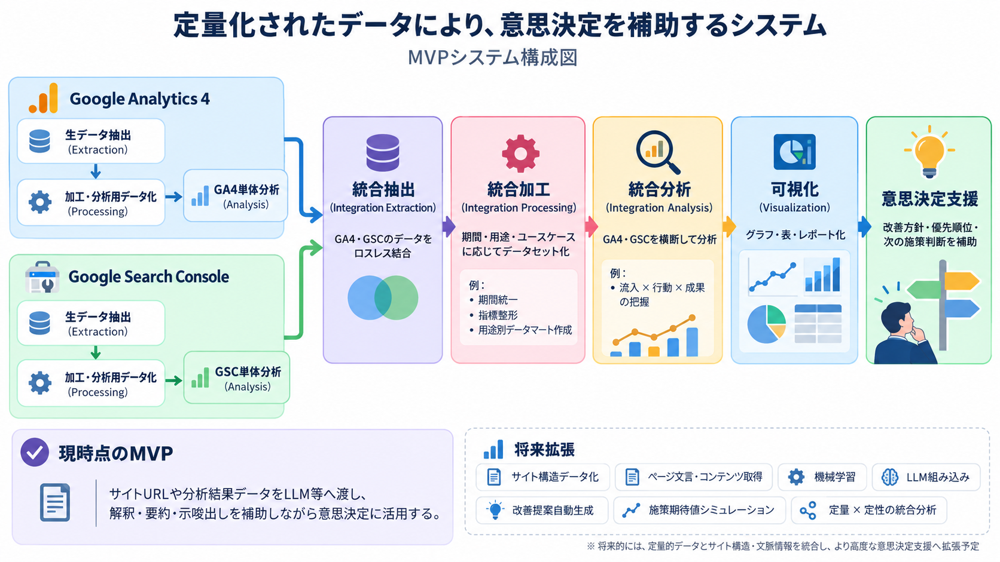

# 汎用Webインテリジェンス意思決定プラットフォーム

> **重要**
>
> - 依頼者の許可が出るまでは、ソースコードを公開できません。現時点で公開対象として扱うのは、**ドキュメントと画像のみ**です。
> - 今回のシステムは、別プロジェクトで開発Agentのquotaを使用していたため、**開発Agentを一切使用せず、通常のChatGPTスレッドのみでMVPまで開発**しました。
> - **MVPは完成済みです。**
> - ソースコードの公開、配布、その他の扱いについては、依頼者の明示的な許可が出るまで保留します。

## このシステムについて

**Generic Web Intelligence & Decision Platform** は、Web上の複数の情報源から得られるデータを、取得・整理・統合・分析・可視化まで一貫して扱い、意思決定につなげるための汎用プラットフォームです。

個別のサイトや単一の分析用途だけに閉じず、将来的なデータソース追加、分析拡張、意思決定支援の高度化を前提として設計しています。

このREADMEは、プロジェクト全体の**入口と導線**だけを扱います。  
設計、要件、処理内容、運用方法、制約、既知事項、MVP後の拡張計画などの詳細は、`docs/public/` 以下の各ドキュメントを参照してください。

## アーキテクチャー概要図

## ドキュメント

公開ドキュメントは `docs/public/` にあります。

主な入口は以下です。

- `docs/public/concept_overview_ja_v2.1.md` — システム全体の考え方と概要
- `docs/public/system_requirements_ja_v3.1.md` — 全体要件
- `docs/public/master_roadmap_ja_v3.1.md` — MVPからPost-MVPまでのロードマップ
- `docs/public/user_manual_ja_v1.2.md` — 利用者向けマニュアル
- `docs/public/dashboard_manual_ja_v1.2.md` — Dashboardの利用・解釈
- `docs/public/system_functions_and_data_processing_details_ja_v1.2.md` — 機能・処理・データの詳細
- `docs/public/development_workflow_and_handoff_guidelines_ja_v1.2.md` — 開発・引き継ぎ・文書更新の運用ルール

上記以外の公開文書も含め、詳細情報は `docs/public/` を正本として参照してください。

## 利用条件・ライセンス

本プロジェクトの公開物について許可される利用は、原則として以下に限定します。

- **閲覧**
- **評価**
- **条件を維持した共有**

それ以外の利用は許可していません。

詳細な許可条件、禁止事項、権利関係、免責その他の条件は、以下を確認してください。

- `LICENSE.txt`
- `NOTICE.md`
- `TERMS_OF_USE.md`

README上の説明より、これらの文書に記載された条件を優先します。

## 公開範囲

現時点で公開対象として想定しているものは、以下です。

- `docs/public/` 以下の公開ドキュメント
- `assets/images/` 以下の公開用画像
- このREADME
- `LICENSE.txt`
- `NOTICE.md`
- `TERMS_OF_USE.md`

**ソースコードは公開対象ではありません。**

公開範囲は、依頼者の許可や今後の判断によって変更される場合があります。

---

## English Summary

**Generic Web Intelligence & Decision Platform** is a general-purpose platform for collecting, organizing, integrating, analyzing, and visualizing web-related data in support of decision-making.

The MVP has been completed.

Until explicit permission is granted by the requester, **the source code cannot be made public**. At this stage, only documentation and images are intended for public release.

This MVP was developed **without using a development Agent**. Because the Agent quota was unavailable due to its use in another project, development was carried out entirely through standard ChatGPT threads.

This README is intentionally limited to a high-level overview and navigation. For requirements, design, operation, data processing, limitations, roadmap, and other details, see `docs/public/`.

Permitted use of the published materials is limited to **viewing, evaluation, and sharing under the stated conditions**. Other uses are not permitted. See `LICENSE.txt`, `NOTICE.md`, and `TERMS_OF_USE.md` for the complete terms.
